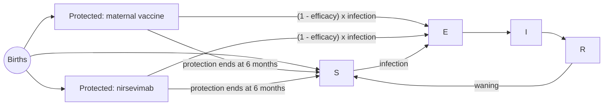
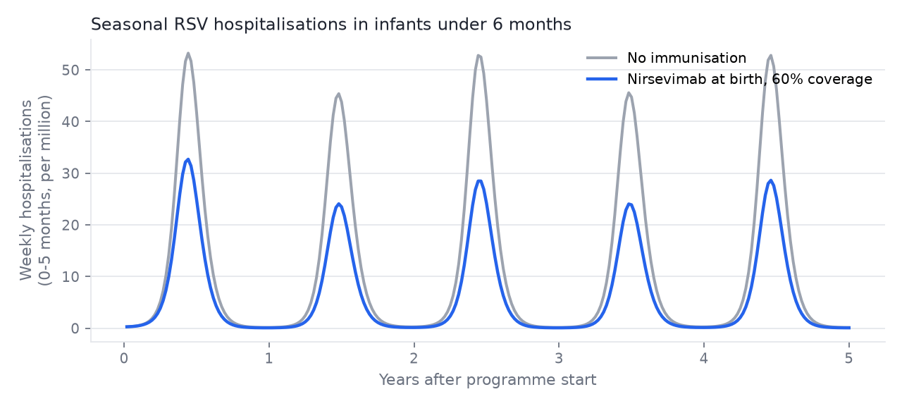
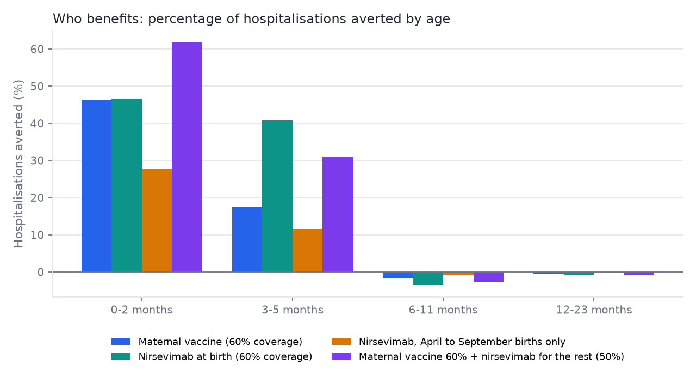
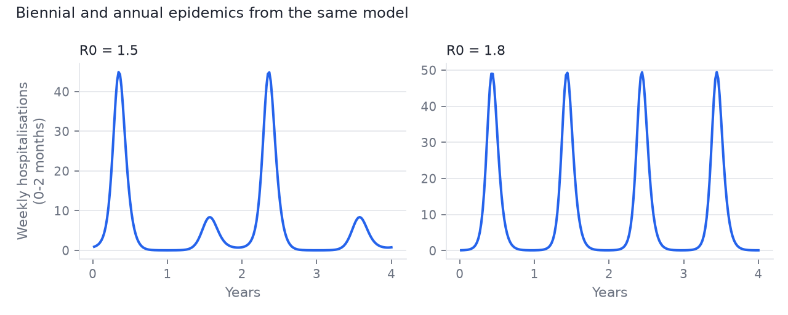
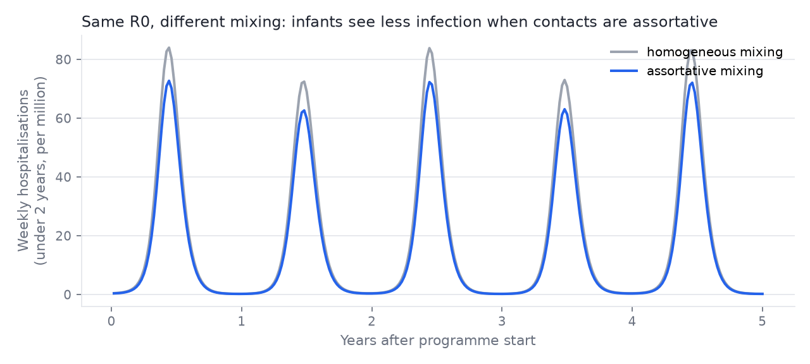

# RSV transmission model with infant immunisation

An age-structured SEIRS model of respiratory syncytial virus (RSV) transmission, used to compare infant immunisation strategies: a maternal RSV vaccine, the long-acting monoclonal antibody nirsevimab, and a combined programme.

I built this to learn infectious disease modelling properly. RSV is personal to my work. My master's research year at the Hunter Medical Research Institute used the Breathing for Life cohort to predict wheeze and bronchiolitis in infants, and bronchiolitis is mostly caused by RSV. That work asks *which* infants are at risk; this model asks *what happens to the whole population* when we protect them.

Live, interactive version: [the RSV Lab on my portfolio](https://gichia-portfolio.vercel.app/lab/rsv), which installs this package and calls `simulate()` behind a FastAPI endpoint.

[](https://github.com/itsgichia/rsv-transmission-model/actions/workflows/ci.yml)

## Questions

1. How much of the RSV hospitalisation burden in infants under two could each strategy avert?
2. Which age groups benefit, and does protecting young infants shift infection to older ages?
3. How much is lost by giving nirsevimab only to babies born in the RSV season?

## Model

Compartments per age class: **S**usceptible, **E**xposed (latent), **I**nfectious, **R**ecovered (temporarily immune), returning to S as immunity wanes. Infants protected at birth sit in separate compartments (maternal vaccine or nirsevimab) for their first six months, with reduced susceptibility.



**Age structure.** 30 classes: monthly from birth to 23 months, then 2 to 4, 5 to 9, 10 to 19, 20 to 39, 40 to 59 and 60 to 79 years. People age continuously between classes; the population is held constant (births balance deaths).

**Transmission.** Seasonally forced, with an age contact matrix $M$:

$$\lambda_i(t) = \sigma_i\, b_0 \left[1 + b_1 \cos\!\left(\frac{2\pi (t - \phi)}{365.25}\right)\right] \sum_j M_{ij}\, \frac{\omega_j I_j}{N_j}$$

where $\sigma_i$ is relative susceptibility (low in the first months because of maternal antibodies), $\omega_j$ is relative infectiousness (lower from age 10) and $M_{ij}$ is the daily contact rate of an age-$i$ person with age-$j$ people. Two mixing modes are available:

- `homogeneous`: $M_{ij} = N_j / N$, everyone mixes equally.
- `assortative`: a synthetic kernel with a strong within-age-band term and a parent-child term about 30 years apart, balanced so that total contacts are symmetric. It is not fitted to a contact survey such as POLYMOD, so it shows the direction of the effect rather than a calibrated magnitude.

In both modes $b_0$ is calibrated so that the spectral radius of the next-generation matrix equals the chosen $R_0$, which keeps scenarios comparable across mixing assumptions.

**Hospitalisations** are the age-specific proportion of new infections hospitalised, reported in four groups (0 to 2, 3 to 5, 6 to 11 and 12 to 23 months).

### Parameters

| Parameter | Value | Source |
|---|---|---|
| Latent period | 4 days | Hogan et al., Western Australia model |
| Infectious period | 9 days | Hogan et al. |
| Duration of immunity after infection | 230 days | Hogan et al. |
| Relative susceptibility, month 0 / months 1 to 2 | 0.08 / 0.45 | Hogan et al. |
| Relative infectiousness, 10 years and over | 0.6 | Hogan et al. |
| Proportion of infections hospitalised (0 to 2 m, 3 to 5 m, 6 to 11 m, 12 to 23 m) | 0.424, 0.088, 0.047, 0.020 | Hogan et al. (fitted to WA data) |
| Basic reproduction number $R_0$ | 1.6 (default) | Chosen; see note |
| Seasonal amplitude $b_1$ | 0.4 | Close to the WA fit (0.397) |
| Peak of transmission forcing | day 100 | Chosen so epidemics peak in June |
| Maternal vaccine efficacy | 80%, waning over months 4 to 6 | Hogan et al. waning profile |
| Nirsevimab efficacy | 80% for 6 months | HARMONIE: 82.7% against hospitalisation to 180 days |

Note on $R_0$: Hogan's models use a contact matrix, so their transmission coefficient cannot be reused directly. With homogeneous mixing I chose $R_0$ so that epidemics peak in winter and infant hospitalisation rates are of a plausible order. At $R_0$ = 1.5 the model gives alternating large and small seasons (biennial, as seen in Perth); at 1.8 it gives regular annual epidemics. This threshold behaviour is one of the findings in Hogan's thesis.

## Results (5 years, 60% coverage, per million population)

| Scenario | 0 to 2 months | 3 to 5 months | Under 2 years |
|---|---|---|---|
| Maternal vaccine | 46% averted | 17% averted | 23% averted |
| Nirsevimab at birth | 47% averted | 41% averted | 27% averted |
| Nirsevimab, April to September births only | 28% averted | 12% averted | 14% averted |
| Maternal vaccine 60% + nirsevimab 50% of the rest | 62% averted | 31% averted | 32% averted |






**What the model suggests**

- The maternal vaccine and nirsevimab protect the youngest infants about equally, but nirsevimab's flat six-month protection does much more for 3 to 5 month olds, where the vaccine's protection is waning.
- A small rise in hospitalisations at 6 to 11 months appears in every scenario. Protected infants who escape infection early are still susceptible when protection ends. The shift is small because older infants are much less likely to be hospitalised.
- Restricting nirsevimab to babies born April to September roughly halves its benefit here, because babies born in late summer reach their first winter at three to five months old with no protection. Australian programmes handle this with catch-up doses before the season, which this model does not yet include.
- Combining both products gives the largest reduction.

## Calibration to NSW notifications (in progress)

`rsvmodel/fit.py` fits $R_0$, the seasonal amplitude and peak day, the duration of immunity, a reporting fraction per age band and a negative-binomial dispersion to monthly notification counts by age, using PyMC's sequential Monte Carlo sampler with the ODE model wrapped as a black-box operator. Priors are written down in `Priors` before any data are touched. The right-hand side is compiled with Numba when no immunisation product is present, which makes a likelihood evaluation about 0.06 s.

The data are NSW RSV notifications by month of onset and age band from September 2022, fetched from the NSW Health Infectious Diseases Data dashboard by `scripts/fetch_nsw_rsv.py` into `data/nsw/rsv_monthly_by_age.csv`. The fit uses January 2023 onward: the 2021 and 2022 seasons followed the lifting of COVID-19 restrictions and are out of phase with the endemic seasonality the model assumes.

Before the fit is pointed at real data it has to pass a parameter-recovery test, `scripts/fit_recovery.py`, which simulates counts from known parameters and checks that the truth falls inside the 95% posterior intervals. The first attempt (2 chains of 200 particles, 25-year burn-in, kept in `results/fit/recovery_200draws_25y/`) failed, covering 8 of 14 parameters: $R_0$ and the duration of immunity trade off along a ridge that 36 months of counts barely constrain, and 200 particles were too few to explore it. The rerun uses 1,000 particles and an even burn-in length (the model settles into a two-year cycle at some parameter values, so the burn-in's parity matters). `scripts/fit_nsw.py` is ready to run once the test passes and writes a summary table, the posterior and a posterior predictive check figure.

```bash
pip install -e ".[fit]"
python scripts/fit_recovery.py --draws 1000 --chains 2 --cores 2     # about 2 h on a laptop
python scripts/fit_nsw.py --draws 1000 --chains 2 --cores 2          # only once recovery passes
```

## Limitations

- **Mixing is schematic.** Homogeneous mixing overstates infant exposure; the assortative kernel is a plausible shape, not a measured one. Under assortative mixing the baseline infant burden falls by about 14% at the same $R_0$ while the percentage averted by each programme barely moves, because direct protection of newborns dominates. The next step is a measured contact matrix (POLYMOD or the projected Australian matrices).
- **Absolute numbers are illustrative.** Hospitalisation proportions were fitted under a different mixing structure, so baseline infant rates are higher than observed in some settings. The percentage reductions are the more robust output.
- Protection reduces susceptibility to infection (as in Hogan's maternal vaccine model), so immunised infants also transmit less. If the products mainly prevent severe disease rather than infection, indirect effects would be smaller.
- No catch-up dosing, preterm infants, or high-risk second-season doses.
- The scenario results above use literature parameters, not parameters fitted to Australian surveillance data. A Bayesian fit to NSW notifications is in progress (see below) and the scenarios will be re-run from its posterior once the parameter-recovery test passes.

## Run it

```bash
python -m venv .venv && source .venv/bin/activate
pip install -e ".[dev]"
pytest -q                         # conservation, non-negativity, dose-response, R0 calibration, CLI
python scripts/run_scenarios.py   # writes figures/ and results/scenario_summary.csv
```

Command line:

```bash
rsvmodel run --maternal 0.6                                   # maternal vaccine, 60% coverage
rsvmodel run --nirsevimab 0.6 --seasonal-only --format csv    # season-restricted nirsevimab
rsvmodel run --maternal 0.6 --nirsevimab 0.5 --mixing assortative --format json
rsvmodel defaults
```

Install into another project straight from GitHub (this is what the portfolio backend does):

```bash
pip install "rsvmodel @ https://github.com/itsgichia/rsv-transmission-model/archive/refs/tags/v0.1.0.tar.gz"
```

```python
from rsvmodel import Params, maternal_vaccine, nirsevimab, simulate
result = simulate(Params(r0=1.6), maternal=maternal_vaccine(0.6), monoclonal=nirsevimab(0.5))
for row in result["summary"]:
    print(row["group"], round(row["percent_averted"], 1))
```

## Repository layout

```
rsvmodel/model.py        the model: age structure, parameters, contact matrix, ODE right-hand side, simulate()
rsvmodel/cli.py          command line entry point
rsvmodel/fit.py          Bayesian calibration: observations, priors, likelihood, SMC fit
scripts/run_scenarios.py reproduces every figure and the results table
scripts/fetch_nsw_rsv.py pulls NSW notifications by month and age into data/nsw/
scripts/fit_recovery.py  parameter-recovery test that gates the real fit
scripts/fit_nsw.py       fits the model to the NSW counts and draws the posterior predictive check
tests/                   pytest suite (runs in CI on Python 3.10 and 3.12)
figures/, results/       outputs of the scenario script, committed so the README renders
```

## References

- Hogan AB, Glass K, Moore HC, Anderssen RS. Exploring the dynamics of respiratory syncytial virus (RSV) transmission in children. *Theoretical Population Biology* 2016;110:78-85.
- Hogan AB, et al. Potential impact of a maternal vaccine for RSV on hospitalisations in Western Australia. Full text: https://core.ac.uk/download/327069014.pdf
- Moore HC, Jacoby P, Hogan AB, Blyth CC, Mercer GN. Modelling the seasonal epidemics of respiratory syncytial virus in young children. *PLoS ONE* 2014. https://pmc.ncbi.nlm.nih.gov/articles/PMC4072624
- Hogan AB. *Mathematical models for respiratory syncytial virus (RSV) transmission.* PhD thesis, Australian National University, 2017.
- HARMONIE Study Group. 180-day efficacy of nirsevimab against hospitalisation for RSV lower respiratory tract infections in infants (HARMONIE). *Lancet Child Adolesc Health* 2025;9(6):404-412.

## Author

Gichia Muiruri, Master of Science (Health Data Science), UNSW Sydney. [LinkedIn](https://www.linkedin.com/in/gichia-muiruri) · [GitHub](https://github.com/itsgichia)
